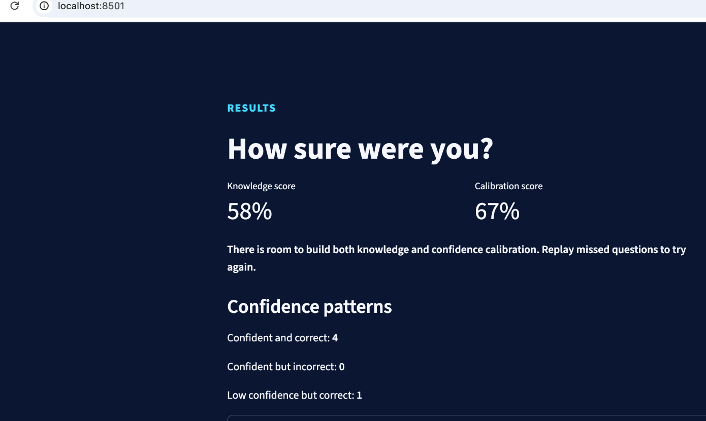

# SURE?

SURE? is a confidence-based general knowledge quiz. The player answers each question and then commits to **Guess**, **Think** or **Know** before feedback is revealed. The aim is to make the player pause and consider not only whether an answer is correct, but how certain they were when answering.

The final prototype contains 12 questions in random order, immediate explanations, a knowledge score, a confidence-calibration score, confidence-pattern feedback, answer review, replay of missed questions and a full restart.



## How to run SURE?

### 1. Download the repository
Download or clone this repository to your computer, then open Terminal in the project folder.

### 2. Install the required package
Run:

```bash
python3 -m pip install -r requirements.txt
```

### 3. Start the quiz
Run:

```bash
python3 -m streamlit run app.py
```

Streamlit will provide a local browser address, normally:

```text
http://localhost:8501
```

Open that address in a browser to use the quiz. Keep the Terminal window open while the app is running. Press `Control + C` in Terminal when finished.

## Project files

- `app.py` - controls the interface, question flow, feedback, results screen and Streamlit session state.
- `quiz_logic.py` - contains the scoring, confidence-pattern and replay logic separately from the interface so it can be tested.
- `questions.json` - stores the 12 quiz questions, answers, explanations and source links.
- `requirements.txt` - lists the package required to run the project.
- `.streamlit/config.toml` - stores the Streamlit theme settings.
- `tests/test_quiz_logic.py` - contains seven unit tests for the scoring and replay logic.
- `results-screen.png` - evidence of the final prototype running locally.

## How the confidence score works

The knowledge score is simply the percentage of correct answers.

The calibration score is a transparent prototype rule scored from 0 to 2 points for each response:

| Result | Guess | Think | Know |
| --- | ---: | ---: | ---: |
| Correct | 0 | 1 | 2 |
| Incorrect | 2 | 1 | 0 |

This rewards high confidence when an answer is correct and low confidence when an answer is incorrect. The score is a learning-oriented prototype metric, not a validated psychological assessment.

## Replay logic

Each response stores the question ID and whether the answer was correct. At the end of the quiz, `missed_question_ids()` filters the incorrect responses. Selecting **Replay missed questions** starts another shuffled round using only those question IDs.

## Testing

From the project folder, run:

```bash
python3 -m unittest discover -s tests -v
```

The final version passes all seven tests covering knowledge scoring, confidence calibration, confidence-pattern counting and replaying missed questions.

## Scope

The A1 pitch identified timed rounds, streaks and category packs as possible stretch features. They were intentionally not added to the final prototype so the core interaction, scoring, testing and explanation could remain clear and achievable.
Using the quiz
Once the application opens:
1. Start the quiz.
2. Select an answer.
3. Choose Guess, Think or Know.
4. Lock in your answer.
5. Read the feedback and explanation.
6. Continue through all 12 questions.
7. View your Knowledge Score and Calibration Score.
8. Review your answers, replay missed questions, or restart the full quiz.
Project scope
The final prototype focuses on the core quiz experience:
- 12 questions
- random question order
- confidence ratings
- immediate feedback
- answer explanations
- knowledge scoring
- confidence calibration
- replaying missed questions
Additional ideas such as timed rounds, category packs and streaks were considered as possible extensions but were intentionally kept outside the final prototype so that the core functionality could be developed and tested properly.
